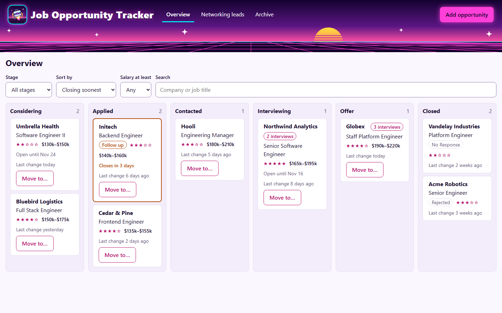
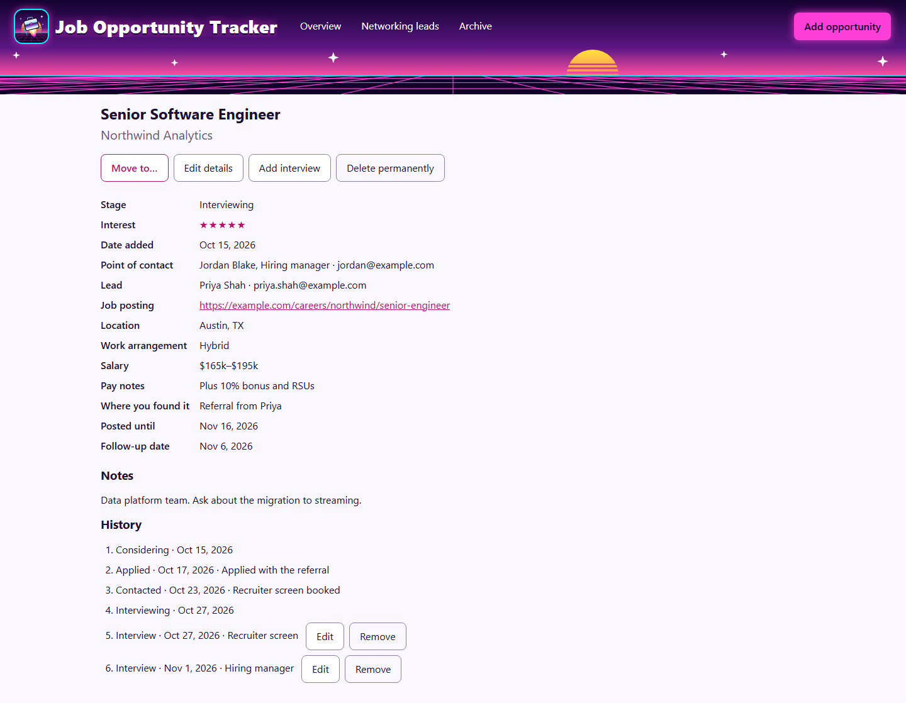
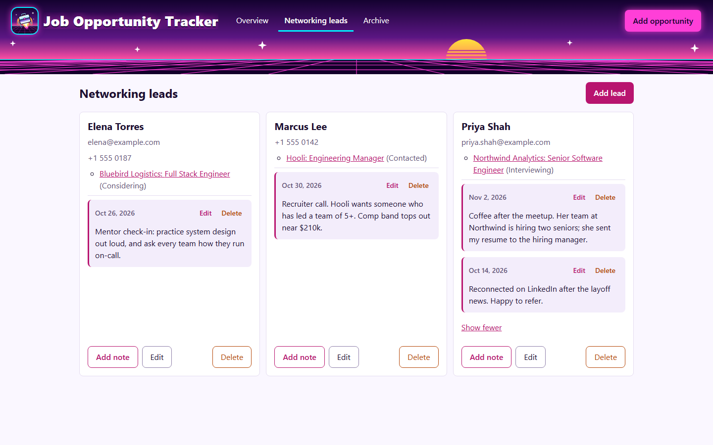
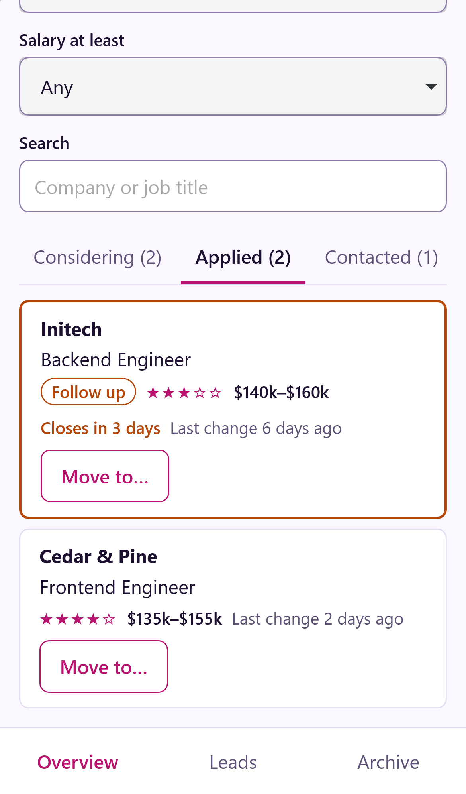
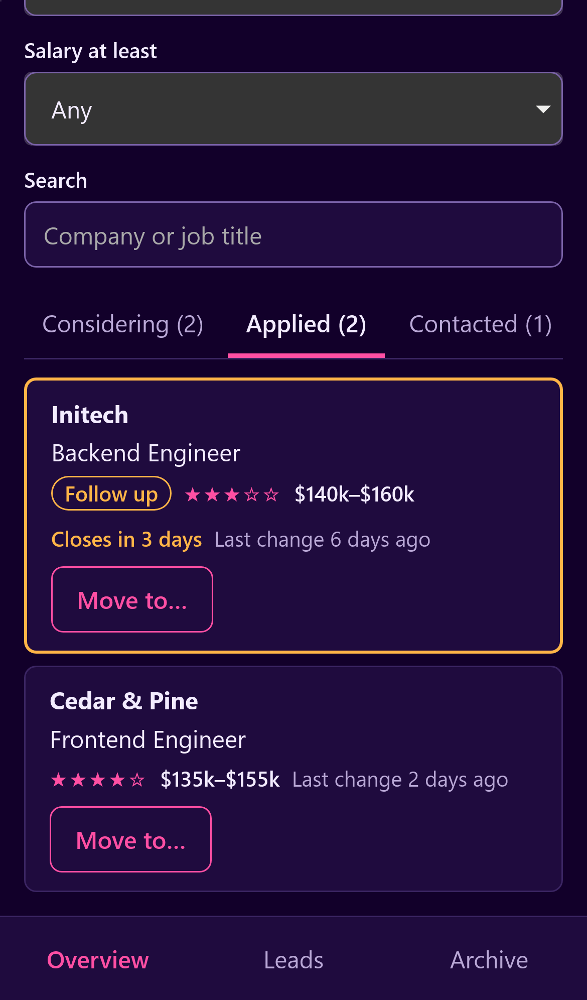
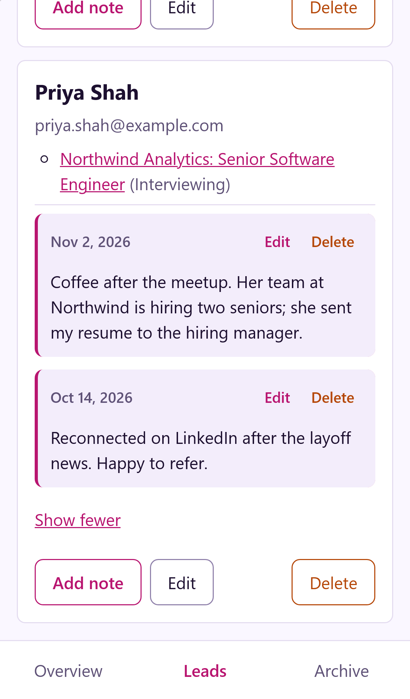
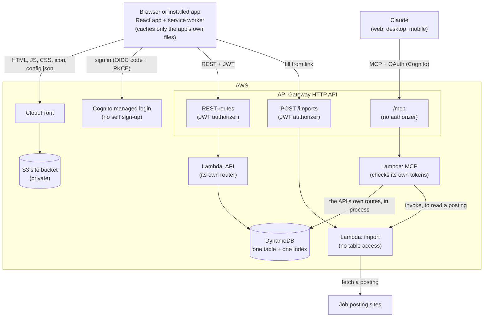
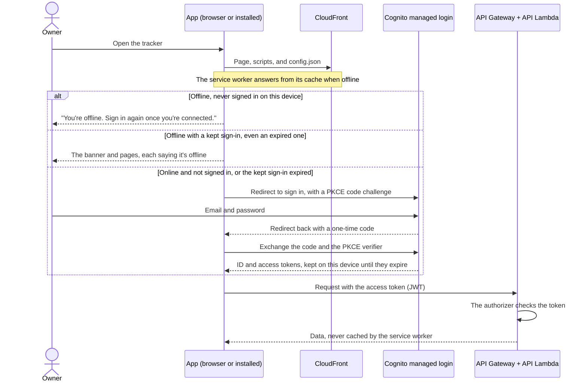

# Job Opportunity Tracker

**Keep your whole job search in one place: every opening, every application, every interview,
and every person helping you along the way. Ask Claude where things stand.**

> **About this repo:** it's a public copy of the private repository I build and run my own
> tracker from. I keep working on the app there and copy it here periodically, so new features
> arrive in batches, each as a single commit, rather than as day-to-day history. Issues and
> suggestions are welcome; changes from pull requests are carried over by hand into the private
> repo and come back in a later update.
>
> What changed in each update is in [CHANGELOG.md](CHANGELOG.md).



<sub>Screenshots use made-up companies and people.</sub>

## Why use this?

Looking for a job is a job. Whether you were laid off and need the next role soon, or you're
employed and quietly looking for something better, the search gets messy fast:

- Twenty open tabs, a spreadsheet you stopped updating, and a pile of "thanks for applying"
  emails.
- A recruiter calls back and you can't remember which role it was, what the salary range was,
  or when you applied.
- A posting you meant to apply to closed last Tuesday.
- A friend introduced you to someone useful three weeks ago, and you've lost track of what you
  talked about.

This app gives that chaos a shape. Each opportunity moves across a board, from **Considering**
to **Applied**, **Contacted**, **Interviewing** and **Offer**, and every step is dated and kept.
You can see at a glance what needs a follow-up, what's closing soon, and what pays enough to be
worth your time.

### Who it's for

- **You need a job now.** Laid off, contract ended, just graduated. Volume matters, and so does
  not dropping the ball. Add a role in seconds by pasting its link, and see every follow-up
  that's due.
- **You're looking while employed.** You have little time and no room for mistakes. Keep it
  private, check it from your phone between meetings, and pick up exactly where you left off.
- **You're changing careers.** The people you meet matter as much as the postings.
  **Networking leads** keep your contacts and notes from each conversation, linked to the roles
  they led to.

### What makes it different

- **It's yours.** It runs in your own AWS account, behind your own sign-in. No ads, no
  recruiter marketplace, and nobody selling your data or your job hunt.
- **It costs next to nothing.** For one person it uses so little that the AWS bill has stayed
  at a few cents a month, and the free tier or credits often cover it.
- **Claude can help.** Connect it to Claude and ask "What's waiting on a follow-up?", "Add this
  posting", or "Move Acme to Interviewing and log today's call". Claude reads and updates your
  tracker, but deleting stays in your hands, in the web app.
- **It works on your phone.** Install it to your home screen; it looks and feels like an app.
- **Fast capture.** A company and a job title are all it needs. Paste a posting's link and
  **Fill from link** brings in the details from most company job sites (not LinkedIn), then
  add more when you have them.

### A quick look

Each opportunity keeps its details, its point of contact, the lead it came through, and a dated
history of every stage change and interview:



**Networking leads** keep the people helping you, the roles they led to, and notes from each
conversation:



On your phone, the board becomes tabs, one stage at a time, in light or dark:

<p>
  
  
  
</p>

### Get your own

Your search deserves better than a forgotten spreadsheet. Fork this repo, follow
[Deployment](#deployment) to put it in your AWS account, and [create your sign-in
user](#creating-your-sign-in-user). Or try it on your computer first with
[Running locally](#running-locally): no AWS account needed, just Docker. If it helps you land
something, a star on the repo would be nice to see. Good luck out there.

## What it does

A personal, responsive web app for tracking job opportunities through a hiring pipeline:
Considering → Applied → Contacted → Interviewing → Offer, through to an outcome. Every stage
change is kept in the opportunity's history.

It's a React app on AWS (S3 + CloudFront, Cognito, API Gateway + Lambda, DynamoDB), defined with
the AWS CDK. The feature spec, plan, and tasks are in
[specs/001-job-opportunity-tracker/](specs/001-job-opportunity-tracker/).

The board shows every open opportunity by stage, then a **Closed** column (a tab on phones)
with each closed one's outcome. Each card shows its salary range (for example "$150k–$180k").
The board can be sorted by either end of the range, and filtered to "Salary at least" an
amount. Anything else about pay goes in **Pay notes**. **Date added** can be set to an earlier
day, for opportunities found before they were entered, and it dates the first history entry.
Adding and editing both show every field at once (feature 011 removed the folded "More
details"). Design: [specs/004-board-and-form-updates/](specs/004-board-and-form-updates/).

After each interview, **Add interview** on the opportunity logs it: the day (today by default)
and an optional note such as "Hiring manager". Interviews appear in the history with the stage
changes and can be edited or removed. A card with interviews shows how many at its top right
("2 interviews"), up to 6 per opportunity. Design:
[specs/005-interview-count/](specs/005-interview-count/).

**Posted until** records the date a posting is up until, when it says. Cards show "Open until
Nov 14", "Closes in 3 days" (in orange, within a week) or "Posting ended Nov 2". The overview
opens sorted by **Closing soonest**: postings still up, soonest first, then those without a
date, then those that have ended. The archive stays sorted by "Recently changed". Design:
[specs/009-posting-deadline/](specs/009-posting-deadline/).

**Networking leads** is a page for the people helping you find jobs before there's a job:
just a name, an email and a phone, with **Add lead** at the top. An opportunity can be linked to
one lead (**Lead** on its form); the opportunity shows its lead, and each lead lists its
opportunities with their stage. Deleting a lead keeps its opportunities, unlinked. Design:
[specs/010-networking-leads/](specs/010-networking-leads/).

Each lead also keeps **notes** from your conversations with them: **Add note** on the lead's card
takes the day (today by default, never in the future) and what was said. The card shows the
newest note, and **Show all** the rest, newest first; each can be edited or deleted. Deleting a
lead deletes its notes. The navigation reads Overview, Networking leads, Archive. Design:
[specs/011-lead-notes/](specs/011-lead-notes/).

## Architecture



The diagrams on GitHub are drawn from [Mermaid](https://mermaid.js.org/) text; update them with
each feature (constitution, Development Workflow).

- **Web**: React 19 and TanStack Query, built by Vite and served from a private S3 bucket
  through CloudFront. CloudFront redirects HTTP to HTTPS, falls back to `index.html` for app
  routes like `/archive`, and adds security headers (HSTS, a content security policy,
  `nosniff`, no framing). The app reads its API and Cognito settings from `/config.json`.
- **Installed app**: a web app manifest lets phones install it, and a small service worker
  (`/sw.js`) keeps the app's own files so it opens offline. Pages come from the network
  first, so each deploy reaches the app on its next launch. API and sign-in requests are never
  cached.
- **Look**: a banner across every page shows the icon's synthwave sunset (feature 008). The
  sky is a CSS gradient, and the sun and neon grid are one SVG strip along its bottom
  (`src/assets/banner-scene.svg`), so the text never sits on their bright parts. On the
  installed iPhone app the sky runs up behind the status bar. Every colour is a token in
  `src/styles/global.css`, with a light and a dark set that follow the device's setting.
  `tests/theme.test.ts` checks each pair used together against WCAG AA.
- **Sign-in**: a Cognito user pool with self sign-up disabled. The app signs in through the
  managed login page with the authorization code flow and PKCE. The tokens are kept on the
  device (`localStorage`) until Cognito's expire, so the installed iPhone app, whose session
  iOS ends on every close, still opens offline.
- **API**: an HTTP API with explicit routes for GET, POST, PATCH, and DELETE, each behind a
  JWT authorizer. There's no route for OPTIONS, so API Gateway answers CORS preflights itself.
  One Lambda serves every route except `POST /imports`.
- **Fill from link**: `POST /imports` runs in its own Lambda with no table access and no other
  permissions, because it fetches pages you paste and parses untrusted HTML. It reaches only
  public web addresses (every address is checked after DNS lookup and on every redirect),
  gives up after 10 seconds or 2 MB, stores nothing, and logs only the host and the outcome.
- **Claude connector**: `/mcp` is a remote MCP server in its own Lambda, so the tracker can be
  used from the Claude apps. It checks every token itself (no API Gateway authorizer), so it can
  answer the `401` that tells Claude where to sign in. Its tools call the web API's own routes in
  the same process, so every rule and message is the web app's, and mark each change "via
  Claude". It reads posting links by invoking the import function, so it never fetches pages
  itself. At most 20 changes a minute go through Claude.
- **Data**: one DynamoDB table. An opportunity, its stage history, and its interviews share a
  partition. A stage change is written in a transaction with its history entry, and an
  interview with the opportunity's interview count (at most 6). An index lists open or
  closed opportunities by their last stage change. Point-in-time recovery is on, and the
  table is kept if the stack is deleted.
- **Infrastructure**: AWS CDK in TypeScript, in five app stacks (Data, WebDistribution, Auth,
  Api, WebContent) plus a budget alert and the one-time CI role.

### Signing in



Claude signs in to the connector with the same user pool, through its own OAuth client; the
MCP function checks each token itself ([specs/003-mcp-server/](specs/003-mcp-server/)).

Why each service was chosen, and the alternatives, are in
[research.md](specs/001-job-opportunity-tracker/research.md). The table layout is in
[data-model.md](specs/001-job-opportunity-tracker/data-model.md).

## Fill from link

On "Add opportunity", paste a job posting link at the top and choose **Fill from link**. The
form fills in from the posting, only in fields that are still empty, and nothing is saved until
you choose "Save opportunity". When the posting states pay, it fills the salary minimum and
maximum, and puts the pay as written (with its currency and period) in "Pay notes". When the posting
states a closing date (schema.org `validThrough`), it fills "Posted until"; Greenhouse postings
don't state one. Design: [specs/002-import-job-from-link/](specs/002-import-job-from-link/).

| Works                                                                                                                                   | Doesn't work                                                                                                                                         |
| --------------------------------------------------------------------------------------------------------------------------------------- | ---------------------------------------------------------------------------------------------------------------------------------------------------- |
| Greenhouse, Lever, Ashby, and Workday postings, and most company careers pages that publish standard job data (schema.org `JobPosting`) | LinkedIn and other sites that need a sign-in; Greenhouse boards embedded on a company's own site (`?gh_jid=` links); pages without standard job data |

When a page can't be read, you see why, and the form is left as it was.

## Install on your phone

The tracker installs like an app, with no app store: it opens full screen from its own icon,
on the board.

- **iPhone (Safari)**: open the site, then **Share → Add to Home Screen**.
- **Android (Chrome)**: open the site, then **⋮ → Install app**.

A new deploy reaches the installed app the next time it opens. With no connection, it still
opens and says it's offline; nothing can be saved until the connection is back (offline editing
is issue #30). A small service worker makes this work: it caches only the app's own files, never
your opportunities. Design: [specs/006-installable-app/](specs/006-installable-app/).

## Use from Claude

Add the tracker to Claude (web, desktop, or mobile) as a custom connector, and Claude can list,
find, and read your opportunities, add new ones (including from a posting link), change their
details (including the salary range and the date added), move them through the pipeline,
log or change interviews, list, add and change networking leads and link opportunities to
them, and read, add and change the notes on a lead. It can't delete anything, including
interviews, leads and notes. Changes made through Claude are marked "via Claude" in the web app. Design: [specs/003-mcp-server/](specs/003-mcp-server/).

1. Get the connector's client ID and secret (they're never in a stack output):

   ```sh
   aws cognito-idp list-user-pool-clients --user-pool-id <pool id>      --query "UserPoolClients[?ClientName=='claude'].ClientId" --output text
   aws cognito-idp describe-user-pool-client --user-pool-id <pool id> --client-id <client id>      --query UserPoolClient.ClientSecret --output text
   ```

2. In Claude: **Settings → Connectors → Add custom connector**. Use the URL `<api>/mcp` (the
   `ApiUrl` output of `Jot-Api`, plus `/mcp`), and enter the client ID and secret under
   **Advanced settings**.
3. Choose **Connect** and sign in with your tracker account. The connector then works in the
   Claude mobile app too.

To stop Claude's access, remove the connector in Claude. Claude Code isn't supported: Cognito
can't register its loopback sign-in callback.

## Prerequisites

- Node.js 24 LTS (see `.nvmrc`) and npm 11+
- Docker Desktop (for DynamoDB Local, from Phase 2 onward)
- First time only: `npx playwright install` to download the end-to-end test browsers

## Commands

| Command                       | What it does                                                                                                |
| ----------------------------- | ----------------------------------------------------------------------------------------------------------- |
| `npm ci`                      | Install all workspaces                                                                                      |
| `npm run dev`                 | Start the app locally on http://localhost:5173                                                              |
| `npm run lint`                | ESLint + Prettier check, all packages, and the check that every test is tagged                              |
| `npm run format`              | Fix formatting with Prettier                                                                                |
| `npm run typecheck`           | `tsc --build`, all packages                                                                                 |
| `npm test`                    | Unit and integration tests (Vitest), all packages                                                           |
| `npm run test:coverage`       | Tests plus the 80% coverage gate (lines, branches, functions, statements)                                   |
| `npm run test:affected`       | Only the tests for what changed since this branch left `master` (see [Test tags](#test-tags))               |
| `npm run test:mutation`       | Mutation testing (Stryker); fails below a 95% mutation score                                                |
| `npm run test:mutation:full`  | Same, ignoring the incremental cache. Use it if a mutant still "survives" after you added a test for it     |
| `npm run test:e2e`            | Playwright end-to-end tests: all on desktop Chrome, `@responsive` ones also on iPhone                       |
| `npm run test:e2e:affected`   | Only the end-to-end tests for what changed since this branch left `master`                                  |
| `npm run build`               | Production build: web app, API bundle, and infrastructure check                                             |
| `node scripts/make-icons.mjs` | Render the app icon (`packages/web/public/icon.svg`) to the PNGs phones use; run it after changing the icon |

## Running locally

`npm run dev` needs Docker Desktop running. It:

1. starts DynamoDB Local on http://localhost:8000 with docker compose, if it isn't already
   running (data persists in the `dynamodb-data` volume)
2. creates the local `JobTracker` table, if it doesn't exist
3. runs the API on http://localhost:3001, restarting on changes. Locally you're signed in as a
   fixed dev user, with no Cognito
4. runs the web app on http://localhost:5173

Your local data lives in the `JobTracker` table in DynamoDB Local, and no test touches it:

- `npm test` starts DynamoDB Local when needed and uses throwaway tables, deleted afterwards.
- `npm run test:e2e` (Playwright) runs its own copy of the app: table `JobTracker-e2e` (wiped
  before every test), API on http://localhost:3101, and web on http://localhost:5174. It can
  run while `npm run dev` is running. The route that wipes data only exists in Playwright's
  copy (`ALLOW_TEST_RESET=true`).

To wipe all local data, including your own: `docker compose down -v`.

## Project layout

| Path              | Contents                                              |
| ----------------- | ----------------------------------------------------- |
| `packages/shared` | `@jot/shared`: domain rules and schemas (no AWS code) |
| `packages/api`    | `@jot/api`: the Lambda handler                        |
| `packages/web`    | `@jot/web`: the React app (Vite)                      |
| `packages/infra`  | `@jot/infra`: the AWS CDK app                         |
| `e2e`             | Playwright end-to-end tests                           |
| `specs`           | Spec Kit feature specs, plans, and tasks              |

## Deployment

The app deploys to AWS (`us-east-1`) from `.github/workflows/deploy.yml` after the CI workflow
passes for a push to `master`. GitHub Actions signs in to AWS with OIDC, so no AWS keys are
stored in GitHub.

One-time bootstrap, done 2026-10-17 (see `specs/001-job-opportunity-tracker/quickstart.md`):

- `cdk bootstrap` for the account in `us-east-1` (the `CDKToolkit` stack)
- `Jot-Ci` stack: the GitHub OIDC provider and the deploy role, which only `master` of this
  repo can assume. It may only assume the CDK bootstrap roles
- GitHub repo variables `AWS_DEPLOY_ROLE_ARN`, `AWS_REGION`, and `BUDGET_EMAIL`. See them with
  `gh variable list`

What each deploy does:

1. Checks out exactly the commit CI tested, then builds the web app and the API.
2. `cdk deploy --all`: updates the stacks, uploads the web app with its `config.json`, and
   clears the CloudFront cache.
3. Runs `e2e/deployed-smoke.spec.ts` against the live site. It checks that the site redirects
   to sign-in, that `/archive` loads, that the security headers are sent, that the API rejects
   a request without a token, and that CORS preflights work.

The live URLs are the `SiteUrl` output of `Jot-WebContent` and the `ApiUrl` output of `Jot-Api`
(`aws cloudformation describe-stacks --stack-name Jot-WebContent`).

### Creating your sign-in user

There's no sign-up page, so create the user once with the AWS CLI. Cognito emails a temporary
password, and the first sign-in asks for a new one:

```sh
# Find the user pool id
aws cloudformation describe-stack-resources --stack-name Jot-Auth   --query "StackResources[?ResourceType=='AWS::Cognito::UserPool'].PhysicalResourceId" --output text

aws cognito-idp admin-create-user --user-pool-id <pool id> --username <your email>   --user-attributes Name=email,Value=<your email> Name=email_verified,Value=true
```

Every user in the pool sees the same data, so create only your own.

### Troubleshooting: certificate errors

Some antivirus products and corporate proxies re-sign HTTPS traffic with their own root
certificate. The operating system trusts that root, but the AWS CLI and Node keep their own
trusted lists. Two environment variables fix this:

- `AWS_CA_BUNDLE`: the AWS CLI's default certificates plus that root
- `NODE_EXTRA_CA_CERTS`: that root, for Node, the CDK CLI, and npm

If you see `CERTIFICATE_VERIFY_FAILED` again, for example after the root is regenerated or an
AWS CLI upgrade, rebuild those files.

## Continuous integration

`.github/workflows/ci.yml` runs on every pull request and every push to `master` (a branch
push alone runs nothing, so each commit is checked once; a manual run can check any branch). A
newer commit cancels the older run for the same pull request or `master`, since only the
latest commit is merged or deployed; deploys are never cancelled. A `changes` job first works
out which tests the change needs (see [Test tags](#test-tags)), then three jobs run, with a fourth alongside them:

- `ci`: lint, typecheck, tests, and build. On `master` it runs every test with the 80% coverage
  gate. On pull requests it runs the affected tests and reports coverage without
  the gate, because a subset of the tests can't cover the whole codebase.
- `e2e`: Playwright tests, all of them on `master`, otherwise only the affected features.
- `mutation`: Stryker mutation testing. The score must be at least 95%; survivors are listed
  in the run's report, to kill with a test later. A mutant that can't be killed because it
  doesn't change behavior may be disabled only with an inline
  `// Stryker disable next-line <mutator>: <reason>` comment. A pull request mutates only the
  source files it changed, and those whose tests it changed (`node scripts/test-tags.mjs
mutate` lists them), static mutants included; a change to dependencies, tool configuration,
  or test helpers tests every mutant. `master` covers every mutant before it deploys.
  Incremental mode reuses a result while neither the mutant's code nor the tests that decided
  it have changed. Each run keeps its results as an artifact (90 days from `master`, 14 from a
  pull request), so a merge to `master` reuses its pull request's results, a pull request's
  next run reuses its last one's, and a new pull request starts from `master`'s, instead of testing every mutant from scratch (about an hour).
  Locally, `npm run test:mutation -- --mutate "<files>"` does the same as a pull request.

- `secrets`: gitleaks scans the pull request's own commits for secrets (on `master`, the whole
  history), so a secret can't be merged in the first place.

A job with nothing to run still passes, so every pull request shows the same four checks.

`.github/workflows/secret-scan.yml` scans the whole git history for secrets with
[gitleaks](https://github.com/gitleaks/gitleaks) on a daily schedule (07:00 UTC). The workflow
is disabled in GitHub's Actions settings to save minutes, since every pull request is already
scanned by the `secrets` check; enable it there (**Actions → Secret scan → ⋯ → Enable
workflow**) to run it daily or by hand again. A finding fails the run; the log shows the file,
line, and commit, with the secret itself redacted. To scan locally:
`docker run --rm -v "$PWD:/repo" zricethezav/gitleaks:v8.28.0 git /repo --redact` (in Git
Bash on Windows, prefix it with `MSYS_NO_PATHCONV=1` and use `$(pwd -W)`).

Code reaches `master` only through a pull request merged after all its checks pass. GitHub Free
doesn't offer branch protection on private repos, so this is a working rule rather than an
enforced setting. Deploys run only when CI succeeds on `master`, where the full suite runs.

### Test tags

Every test is tagged with the functionality it checks, and
[scripts/test-tags.mjs](scripts/test-tags.mjs) maps every source file to the tags whose tests
exercise it.

| Tag           | Functionality                                                                                                                                     |
| ------------- | ------------------------------------------------------------------------------------------------------------------------------------------------- |
| `core`        | Common code every feature runs on: shared schemas, the API router and data access, the web shell, auth, the API client, test helpers, and tooling |
| `capture`     | Adding and viewing an opportunity (US1)                                                                                                           |
| `pipeline`    | Moving through stages, and the stage history (US2)                                                                                                |
| `overview`    | The stage board, the archive, and filter, sort, and search (US3)                                                                                  |
| `edit`        | Editing, deleting, duplicate warnings, and follow-up flags (US4)                                                                                  |
| `import`      | Filling the add form from a job posting link (feature 002)                                                                                        |
| `installable` | Installing the app on a phone, offline open, and updates (feature 006)                                                                            |
| `interview`   | Logging interviews and the interview count (feature 005)                                                                                          |
| `mcp`         | Using the tracker from Claude: the MCP server (feature 003)                                                                                       |
| `theme`       | The banner and the site colours (feature 008)                                                                                                     |
| `deadline`    | The posting's closing date, the card's deadline text, and the Closing soonest sort (feature 009)                                                  |
| `leads`       | Networking leads: the page, their notes, linking opportunities to them, and Claude's lead tools (features 010–011)                                |
| `infra`       | The AWS CDK stacks and the deploy workflow                                                                                                        |

How a change picks its tests:

- A changed source file runs the tests for its tags. Code that several features use lists each
  of them; for example, `OpportunityDetail.tsx` runs the `capture`, `pipeline`, and `edit` tests.
- A changed test file runs the tags it declares.
- A change to `core` runs every test. So does any file the map doesn't recognize, such as
  dependencies or tool config, and a new source file until it's added to the map.
- Documentation (`*.md`, `specs/`) runs nothing.

How to tag:

- **Vitest**: a first line of `// @module-tag <tag>`, or, in a file that mixes features, a tag on
  each top-level block: `describe('Archive', { tags: ['overview'] }, () => { ... })`. Vitest
  rejects a tag that isn't defined in `scripts/test-tags.mjs`.
- **Playwright**: wrap the spec in `test.describe('Edit and delete (US4)', { tag: '@edit' }, ...)`.
  `@responsive` and `@deployed` say where a test runs, not what it checks, and don't count.
- When you add a source file that belongs to one feature, add it to `SOURCE_TAGS`. `npm run lint`
  fails if a test is untagged, a tag is unknown, or a pattern in the map matches no file.

## License

[MIT](LICENSE)
