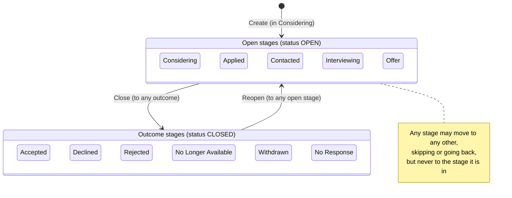

# Data Model: Job Opportunity Tracker

Derived from [spec.md](./spec.md) (Key Entities, FR-001–FR-023). The storage approach and its
rationale are in [research.md](./research.md).

Later features add to this model; the table layout below includes their items:

- **003, Claude connector**: the `via` marker on changes made through Claude
  ([data model](../003-mcp-server/data-model.md))
- **004, board and form updates**: salary fields and a settable date added
  ([data model](../004-board-and-form-updates/data-model.md))
- **005, interview count**: interview items and the opportunity's `interviewCount`
  ([data model](../005-interview-count/data-model.md))

## Entities

### Opportunity

| Field | Type | Required | Rules |
|---|---|---|---|
| `id` | string (ULID) | yes (system) | Assigned on create |
| `company` | string | **yes** | Trimmed, 1–200 characters (FR-001, FR-002) |
| `title` | string | **yes** | Trimmed, 1–200 characters (FR-001, FR-002) |
| `contact` | Contact | no | See Contact below |
| `description` | string | no | Up to 20,000 characters, line breaks kept (edge case) |
| `interest` | integer 1–5 or null | no | null means "not rated" (edge case) |
| `postingUrl` | string (URL) | no | Must be `http` or `https` |
| `location` | string | no | Up to 200 characters |
| `workArrangement` | enum | no | `ONSITE`, `HYBRID`, `REMOTE` |
| `compensation` | string | no | Free text, up to 500 characters |
| `source` | string | no | Free text, up to 200 characters (for example "LinkedIn", "Referral: Sam") |
| `followUpDate` | date (YYYY-MM-DD) | no | Highlighted when it is today or earlier (FR-020). "Today" is the browser's local date |
| `notes` | string | no | Up to 20,000 characters |
| `stage` | Stage | yes (system) | `CONSIDERING` on create (FR-009) |
| `status` | `OPEN` or `CLOSED` | yes (system) | Derived from the stage category. Never set directly |
| `createdAt` | ISO datetime | yes (system) | Date added (FR-004) |
| `updatedAt` | ISO datetime | yes (system) | Changed on every write |
| `lastStageChangeAt` | ISO datetime | yes (system) | Most recent `changedAt` in the history |
| `changeCount` | integer | yes (system) | Number of history entries. Used for optimistic locking |

**Validation**: `company` and `title` can't be removed or cleared by an edit (FR-005, User
Story 4 scenario 3). Any field except system fields may be edited.

### Contact (embedded in Opportunity)

| Field | Type | Rules |
|---|---|---|
| `name` | string | Up to 200 characters |
| `role` | string | Up to 200 characters |
| `email` | string | Valid email format if given |
| `phone` | string | Free text, up to 50 characters |

All fields are optional. If every field is empty, the contact is treated as absent.

### Stage (fixed list, in `packages/shared/src/stages.ts`)

| Order | Stage | Category |
|---|---|---|
| 1 | `CONSIDERING` | open |
| 2 | `APPLIED` | open |
| 3 | `CONTACTED` | open |
| 4 | `INTERVIEWING` | open |
| 5 | `OFFER` | open |
| 6 | `ACCEPTED` | outcome |
| 7 | `DECLINED` | outcome |
| 8 | `REJECTED` | outcome |
| 9 | `NO_LONGER_AVAILABLE` | outcome |
| 10 | `WITHDRAWN` | outcome |
| 11 | `NO_RESPONSE` | outcome |

### StageChange (history entry)

| Field | Type | Rules |
|---|---|---|
| `opportunityId` | string | Parent opportunity |
| `seq` | integer | 1, 2, 3, … in the order changes were entered. The current stage comes from the highest `seq` |
| `fromStage` | Stage or null | null only for `seq = 1` (creation) |
| `toStage` | Stage | Must differ from `fromStage` |
| `changedAt` | ISO datetime | Defaults to now. May be earlier. Must not be in the future (FR-014) |
| `note` | string or null | Up to 2,000 characters |
| `recordedAt` | ISO datetime | When the entry was actually saved (audit) |

Creating an opportunity also writes the first entry: `seq=1`, `fromStage=null`,
`toStage=CONSIDERING`.

## Stage-change rules (pure functions in `packages/shared/src/transitions.ts`)

1. Moving from any stage to any other stage is allowed, including skipping stages and moving
   backward (FR-010).
2. `toStage == current stage` is rejected as `SAME_STAGE`, and no entry is recorded (edge case).
3. A `changedAt` later than now (allowing 1 minute of clock skew) is rejected as
   `FUTURE_DATE` (FR-014).
4. `status` = `CLOSED` when `toStage` is an outcome stage, otherwise `OPEN`. Moving from an
   outcome stage to an open stage reopens the opportunity (FR-011).
5. After a change, `lastStageChangeAt` = the latest `changedAt` across all entries (because of
   backdating, this is not always the new entry's date).

## Duplicate detection (`packages/shared/src/duplicates.ts`)

A new opportunity is flagged as a possible duplicate when an **open** opportunity has the same
`company` and `title`, compared case-insensitively with whitespace collapsed. This is a warning
only: the user can continue anyway (FR-006).

## DynamoDB single-table layout

Table `JobTracker`: on-demand capacity, point-in-time recovery on.

| Item | PK | SK | GSI1PK | GSI1SK |
|---|---|---|---|---|
| Opportunity | `OPP#<id>` | `OPP` | `STATUS#OPEN` or `STATUS#CLOSED` | `<lastStageChangeAt>#<id>` |
| StageChange | `OPP#<id>` | `CHANGE#<seq, zero-padded to 6>` | — | — |
| Interview (005) | `OPP#<id>` | `INTERVIEW#<ulid>` | — | — |

### Access patterns

| # | Pattern | Operation |
|---|---|---|
| A1 | List open opportunities (overview) | Query GSI1 `GSI1PK = STATUS#OPEN` |
| A2 | List closed opportunities (archive) | Query GSI1 `GSI1PK = STATUS#CLOSED` |
| A3 | Get an opportunity with its full history | Query `PK = OPP#<id>`: one call returns the `OPP` item and every `CHANGE#` and `INTERVIEW#` item |
| A4 | Create an opportunity | TransactWrite: Put `OPP` (condition: does not exist) + Put `CHANGE#000001` |
| A5 | Change stage | TransactWrite: Update `OPP` (condition `changeCount = :n`) + Put `CHANGE#<n+1>` |
| A6 | Edit details | Update `OPP` (condition: exists). Never touches stage fields |
| A7 | Permanent delete | Query `PK = OPP#<id>`, then batch-delete every item |
| A8 | Add or remove an interview (005) | TransactWrite: Put or Delete `INTERVIEW#<ulid>` + Update `OPP` `interviewCount` (at most 6) |
| A9 | Edit an interview (005) | Update `INTERVIEW#<ulid>` (condition: exists) |

Filtering by stage, sorting, search (FR-018, FR-019), and the follow-up highlight (FR-020) are
done in the browser on the A1 result. At most a few hundred items keeps this well under 1 s
(SC-004) and avoids extra indexes (Principle V).
