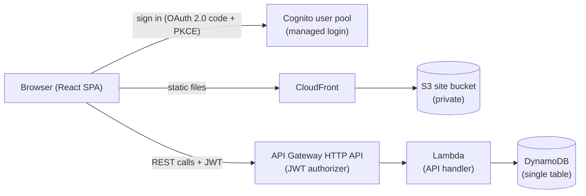

# Research: Job Opportunity Tracker

Phase 0 decisions for [plan.md](./plan.md). This is a learning project. Each AWS service below
is included only if it does a real job in this app. Services that were considered and left out
are listed at the end with the reason.

## 1. Architecture overview

## 2. Decisions

### Frontend hosting: S3 + CloudFront
- **Decision**: Build the React app with Vite, upload it to a private S3 bucket, and serve it
  through CloudFront with Origin Access Control. SPA routes fall back to `index.html`.
- **Rationale**: This is the standard AWS pattern for static sites. It gives HTTPS by default
  and costs almost nothing at this traffic, and you learn two core services.
- **Alternatives**: Amplify Hosting is simpler, but it hides the S3 and CloudFront pieces,
  which works against the learning goal. Serving from Lambda would be slower and costs more.

### Authentication: Amazon Cognito
- **Decision**: A Cognito user pool with self sign-up disabled. Your single user is created by
  an admin. The SPA signs in through Cognito managed login using authorization code + PKCE
  (`react-oidc-context`). The HTTP API checks the JWT with a built-in JWT authorizer.
- **Rationale**: Principle IV requires that the data be private. Cognito is the native AWS
  identity service and needs no custom auth code.
- **Alternatives**: An API key or basic auth is not secure enough from a browser. Amplify Auth
  adds a large library. IAM-signed requests through Cognito identity pools are more complex
  than this app needs.

### API: API Gateway HTTP API + one Lambda
- **Decision**: An HTTP API (v2) with one Lambda that routes requests internally ("lambdalith")
  in TypeScript on Node.js.
- **Rationale**: HTTP APIs are cheaper and simpler than REST APIs and include JWT authorizers.
  One function keeps deployment and cold starts simple for about 8 routes (Principle V).
- **Alternatives**: REST API (v1) has features this app doesn't need, such as usage plans and
  request validation. One Lambda per route means more infrastructure for no benefit at this
  size. AppSync/GraphQL is a larger learning curve than this simple CRUD needs.

### Database: DynamoDB, single-table design
- **Decision**: One table with `PK`/`SK` and one global secondary index (GSI1). An opportunity
  and its stage changes share a partition, so one Query loads an opportunity with its full
  history. Details are in [data-model.md](./data-model.md).
- **Rationale**: The access patterns are few and known in advance: list open, list closed, get
  one with history, change stage. DynamoDB fits them well. On-demand capacity costs about $0
  when idle.
- **Key DynamoDB concepts you'll learn**: partition and sort keys, a GSI, Query vs. Scan,
  `TransactWriteItems`, condition expressions for optimistic locking, and point-in-time
  recovery.
- **Alternatives**: Aurora Serverless or RDS have an idle cost and the relational model isn't
  needed. A table per entity would be the more traditional approach, but the shared partition
  is the more instructive design.

### Stage changes: DynamoDB transaction + optimistic locking
- **Decision**: A stage change runs one `TransactWriteItems` call. It updates the opportunity's
  `stage`, `status`, `lastStageChangeAt`, and `changeCount`, with the condition
  `changeCount = :expected`, and puts the `CHANGE#<seq>` history item. If the transaction fails,
  nothing is written.
- **Rationale**: Principle II requires that history is never lost. A stage update without its
  history entry, or the other way round, must be impossible. If the same change is sent twice,
  for example after a double tap or a retry, the second attempt fails the condition and is
  reported as a conflict.

### Backdated changes and the current stage
- **Decision**: The current stage is always the stage from the **most recently recorded**
  change, in the order the changes were entered (`seq`), not the order of their dates.
  `changedAt` defaults to now, may be earlier, and must not be in the future. History is
  displayed sorted by `changedAt`, then by `seq`. "Time since last change" uses the most recent
  `changedAt` in the history.
- **Rationale**: When you record "I applied last Tuesday", you expect the opportunity to show
  as Applied right away, even if an earlier-dated entry already exists. Ordering by entry order
  avoids confusing reordering.

### Step Functions: planned for follow-up reminders (later feature)
- **Decision**: Not used in feature 001. Planned for a later **follow-up reminders** feature:
  - Setting a `followUpDate` starts a workflow that uses a **Wait state until that timestamp**.
  - The workflow then sends an email reminder through **Amazon SES**.
  - Changing or clearing the date stops the old execution and, if needed, starts a new one.
- **Rationale**: This is a natural fit. The workflow waits for days or weeks for free, with no
  polling or cron job. Each reminder's state is visible in the console.

### Infrastructure as code: AWS CDK (TypeScript)
- **Decision**: A CDK v2 app in `packages/infra`. Deployment runs `cdk deploy --all`.
  - **Stack order**: Data → WebDistribution → Auth → Api → WebContent, plus Budget and CI.
  - **Why this order**: the Cognito redirect URLs and the API's allowed origins need the
    CloudFront domain. The web app needs the API URL and Cognito settings. Creating the
    distribution first, and writing the settings to a runtime `config.json` last, avoids a
    circular dependency between stacks.
- **Rationale**: It uses the same language as the app, includes high-level constructs (for
  example, a DynamoDB grant gives the Lambda only the permissions it needs), and supports
  testing with assertions. It meets Principle VII's rule that deployment is automated.
- **Alternatives**: SAM is good for Lambda, but less convenient for CloudFront and Cognito.
  Terraform is not AWS-native and adds another language. ClickOps (setting things up by hand in
  the console) violates Principle VII.

### CI/CD: GitHub Actions + OIDC
- **Decision**:
  - `ci.yml` runs on every push and PR: `npm ci`, `lint`, `typecheck`, `test`, `build`, and
    `cdk synth`. Integration and e2e tests start DynamoDB Local through docker compose, using
    the same `ensure-dynamodb-local` script as local development.
  - `deploy.yml` runs on push to `master`, after CI passes. It assumes an IAM role through
    GitHub's OIDC provider and runs `cdk deploy`.
  - Branch protection on `master` requires CI to pass.
- **Rationale**: The repository is already on GitHub. OIDC avoids storing long-lived AWS access
  keys, which is current best practice.
- **Alternatives**: CodePipeline and CodeBuild are AWS-native, but they add services and cost
  and duplicate what GitHub already provides.

### Local development
- **Decision**: `npm run dev` starts DynamoDB Local (docker compose), creates the table, starts
  the API on `localhost:3001` through a thin Node HTTP adapter around the same Lambda handler,
  and starts Vite on `localhost:5173`. In local mode, auth is bypassed with a fixed dev user;
  this only works when `APP_ENV=local`.
- **Rationale**: You can run everything locally with one command and no AWS costs or
  credentials (Principle VII).
- **Alternatives**: LocalStack covers more services, but it's heavier and parts of it are paid.
  SAM local is slow and needs Docker for every Lambda invocation.

### Tooling
- **Decision**: npm workspaces, TypeScript project references, ESLint (flat config) with
  typescript-eslint and react-hooks, Prettier, Vitest everywhere, and React Testing Library.
- **Rationale**: Vitest pairs naturally with Vite and works for both Node and browser code, so
  there's one test runner for the whole repo.

### Coverage and mutation testing (Constitution Principle VI)
- **Decision**:
  - **Coverage**: Vitest's V8 provider (`@vitest/coverage-v8`), configured in the root
    `vitest.config.ts`. `npm run test:coverage` fails if lines, branches, functions, or
    statements drop below 80%, measured across all packages.
  - **Mutation testing**: Stryker (`@stryker-mutator/core`, the Vitest runner, and the
    TypeScript checker) in `stryker.config.json`, with `thresholds.break: 100`, so any
    surviving mutant fails the run. Mutants that don't compile are discarded by the
    TypeScript checker and don't count.
  - **Speed**: per-test coverage analysis runs only the tests that cover each mutant.
    Incremental mode (`reports/stryker-incremental.json`, cached in CI) re-tests only changed
    code.
  - **CI**: runs as its own `mutation` job, because it is slower than the other checks.
  - **Incremental caveat**: incremental mode can keep a stale "Survived" result after a new
    test is added for that mutant, which is a safe failure. `npm run test:mutation:full`
    (`--force`) re-runs everything.
- **Vitest is pinned to 4.1**: Stryker's Vitest runner (10.0.0) is broken with Vitest 5. It
  runs zero tests per mutant, so every mutant "survives"
  ([stryker-js#6210](https://github.com/stryker-mutator/stryker-js/issues/6210); fix proposed in
  #6214 but not released as of 2026-10-17). This was reproduced here before pinning. Upgrade
  Vitest to 5 once a runner release includes the fix, then re-check that mutation testing
  reports real kills.
- **Rationale**: Coverage only shows which code the tests run. Mutation testing shows the
  tests would catch a broken change. On the first run it already found an untested response
  header.
- **Alternatives**: Istanbul coverage works, but V8 is faster and needs no instrumentation
  step. Patching the Stryker runner by hand (the #6214 diff) would keep Vitest 5, but the
  patch would break on every reinstall.

### End-to-end tests: Playwright
- **Decision**: Use Playwright (`@playwright/test`) in a root `e2e/` folder.
  - **Specs**: one per user story, following the quickstart checks.
  - **Projects**: `desktop-chromium` (Desktop Chrome), `mobile-webkit` (iPhone 14), and
    `mobile-chromium` (Pixel 7), so the responsive layout and touch flows are tested, including
    Safari's engine.
  - **Combinatorial split** (decided 2026-10-17, to keep the e2e run small as stories are
    added): every scenario runs on `desktop-chromium`. A scenario whose behavior depends on the
    device is tagged `@responsive` and also runs on both phones. That means layout that changes
    by width, touch-only controls, or form controls that Safari renders differently (date,
    radio, select). Every scenario and every device stays covered, but not every scenario × every
    device: 12 runs instead of 18 after US1, and about 35 instead of 75 projected at the end.
    Tag a new scenario `@responsive` whenever its behavior could differ on a phone.
  - **Local runs**: Playwright's `webServer` starts the local stack (`npm run dev`) in local
    auth mode.
  - **Isolation**: a dev-only reset endpoint, which exists only in the local server, clears data
    between tests.
  - **CI**: runs as the `e2e` job on every push and PR, with the HTML report and traces uploaded
    when a test fails.
  - **After deploy**: a small `@deployed` smoke test runs against the CloudFront URL. It checks
    that the site loads and redirects to Cognito sign-in, and that the API rejects calls without
    a token.
- **Rationale**: The user asked for Playwright. It covers all three browser engines, has good
  mobile emulation, and produces traces for debugging.
- **Alternatives**: Cypress has weaker WebKit/Safari support and multi-tab handling. Running the
  full user-story suite against the deployed app would need a real Cognito test user and
  password in CI, so it is limited to the smoke test.

### Responsive UI
- **Decision**: Mobile-first CSS Modules.
  - **Desktop (≥ 1280 px)**: the overview is a board with one column per open stage.
    Originally 1024 px; moved to 1280 px on 2026-10-29, when the Closed column (feature 004) was
    found cut off: six columns need about 1280 px to keep a card readable. The board shares
    the width between its columns and may use up to 96rem, wider than other pages.
  - **Phones**: stage tabs with a list of cards.
  - **Moving a stage**: done with a "Move to…" menu (a bottom sheet on mobile, a centered
    dialog on desktop) instead of drag-and-drop, so it works the same way with touch and mouse and meets SC-002.
- **Rationale**: This meets the responsive requirement without a UI framework (Principle V).
  Drag-and-drop could be added later.

### Cost guardrails: AWS Budgets
- **Decision**: An AWS Budgets monthly budget, for example $5, that emails an alert at 80%,
  defined in CDK.
- **Rationale**: In a learning AWS account, it's easy to leave something expensive running. One
  alarm protects against surprise bills. Expected monthly cost is well under $1.

## 3. Services considered and not used (for now)

| Service | Why not |
|---|---|
| Amplify (Hosting/Auth) | Hides the parts you want to learn, and adds a large client library |
| AppSync / GraphQL | Simple CRUD doesn't need it |
| RDS / Aurora | Idle cost, and a relational model isn't needed |
| Step Functions | Nothing in this feature needs a workflow. Planned for the follow-up reminders feature (see above) |
| SES | Only needed to send reminder emails. Part of the follow-up reminders feature |
| SQS / SNS | No message fan-out or queueing needed |
| X-Ray, CloudWatch dashboards | CloudWatch logs (default) are enough for one user. Add when needed |
| WAF, Route 53 custom domain | Optional. The CloudFront default domain works. A custom domain can be a small later change |
| Secrets Manager | No secrets: Cognito and OIDC replace keys |
| CodePipeline / CodeBuild | GitHub Actions already covers CI/CD |
