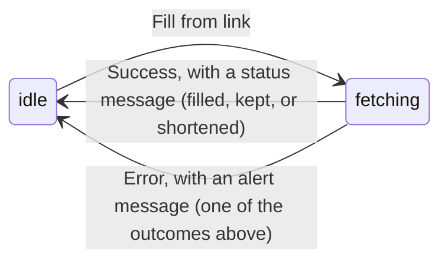

# Data Model: Import Job Details from a Posting Link

**Feature**: [spec.md](./spec.md) | **Date**: 2026-10-19

Nothing new is stored. This feature adds a request, a response, and the rules for filling the
form. The Opportunity entity and its table layout are unchanged from feature 001
([data-model.md](../001-job-opportunity-tracker/data-model.md)).

## ImportRequest

| Field | Type | Rules |
|---|---|---|
| `url` | string | Required. A valid `http` or `https` URL (the same rule as the opportunity's `postingUrl`), and at most 2,000 characters. |

## PostingDetails (the successful response)

Every field except `source` and `filled` is optional. A field is left out when the posting
doesn't state it, never sent as an empty string.

| Field | Type | Maps to form field | Rules |
|---|---|---|---|
| `company` | string | Company | At most 200 characters (the opportunity limit). |
| `title` | string | Job title | Required in a success: a posting without a title is `NO_JOB_DETAILS`. At most 200 characters. |
| `description` | string | Job description | Plain text. At most 20,000 characters. |
| `descriptionTruncated` | boolean | (notice) | `true` when the description was cut to fit (spec FR-008). |
| `location` | string | Location | At most 200 characters. |
| `workArrangement` | `REMOTE` \| `HYBRID` \| `ONSITE` | Work arrangement | Only when the posting clearly says so (research §2). |
| `compensation` | string | Compensation | Formatted text, for example "$150,000–$180,000 a year". At most 500 characters. |
| `source` | string | Where you found it | The site's name (research §2). Always present. |

The field limits match feature 001's `OpportunityInput` schema, so a filled form always passes
the same validation as a typed one. Longer values are cut to the limit; only the description
reports it.

## Import outcomes (the error response)

A failed import returns HTTP 422 with the existing error body, `{ code, message }`. The
message is the plain-language text from research §4, defined once in the shared package so the
API and the browser agree.

| `code` | Meaning |
|---|---|
| `SIGN_IN_REQUIRED` | The site needs a sign-in or blocks reading. |
| `NO_JOB_DETAILS` | No job posting data on the page. |
| `MULTIPLE_JOBS` | The page lists more than one posting. |
| `UNREACHABLE` | The page couldn't be loaded (network, timeout, 404, 5xx, too large, not HTML). |
| `URL_NOT_ALLOWED` | The link isn't a public `http` or `https` page. |

An invalid body (no `url`, or not a URL) is the existing `VALIDATION_ERROR` with HTTP 400.

## Fill rules (browser, `features/import/fillForm.ts`)

Input: the form's current values and a `PostingDetails`. Output: the new values, the fields that
were filled, and the fields that were kept.

1. For each mapped field: if the form's value is empty after trimming, it takes the posting's
   value and goes in **filled**.
2. If the form's value isn't empty and the posting has a **different** value, the form's value
   stays and the field goes in **kept**. The same value counts as neither.
3. `postingUrl` is never changed: the link the owner pasted is the one saved (spec FR-007).
4. Interest, contact, follow-up date, and notes are never touched (spec Assumptions).
5. When any filled field is in "More details", that section opens so the owner can review it.

## State in the form

While **fetching**, the button is disabled and reads "Filling…". The Save button stays usable,
so a slow fetch never blocks saving by hand.
