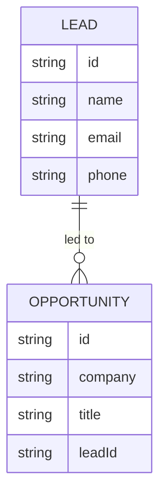

# Data Model: Networking Leads

## Networking lead (new)

A person who helps the owner find jobs. Stored in the existing table (research §1).

| Field | Type | Rules |
|---|---|---|
| `id` | string | Generated, like an opportunity's id |
| `name` | string | Required. Trimmed, 1–200 characters ("Name is required") |
| `email` | string? | Optional. Trimmed; a valid email ("Enter a valid email address"), as for the contact |
| `phone` | string? | Optional. Trimmed, up to 50 characters, as for the contact |
| `createdAt` | ISO date-time | Set when added |
| `updatedAt` | ISO date-time | Set on every edit |

- **Only these fields**: input with any other field is refused, as for the contact
  (`unknownFieldError`).
- **Blank values**: on add, a blank email or phone is left out. On edit, `null` or blank clears
  one. The name can't be cleared.
- **No stage, history, notes or archive**: deleting is the only way to remove a lead, and it
  needs confirming (spec FR-005).

**Keys**: `PK = LEAD#<id>`, `SK = LEAD`, `GSI1PK = LEADS`, `GSI1SK = <id>`.

### Lead with its opportunities (response only)

`GET /leads` returns each lead with `opportunities`: a list of `{ id, company, title, stage,
status }`, newest stage change first. It's built when read, not stored.

## Opportunity (changed)

| Field | Type | Rules |
|---|---|---|
| `leadId` | string? | Optional. The id of an existing lead. On edit, `null` or blank removes it. Unknown ids are refused ("That lead doesn't exist") |

- **Not stage changes**: setting, changing or removing it adds no history entry and doesn't
  change `lastStageChangeAt` (spec FR-008).
- **Kept**: it stays when the opportunity moves stage or closes.
- **Deleting the lead** removes `leadId` from every linked opportunity and sets their
  `updatedAt` (research §3).
- **A link to a missing lead** is read as no lead (research §4).

## Relationships

A lead has any number of opportunities; an opportunity has at most one lead.

**Later**: feature 011 gives each lead dated notes; see
[its data model](../011-lead-notes/data-model.md).
