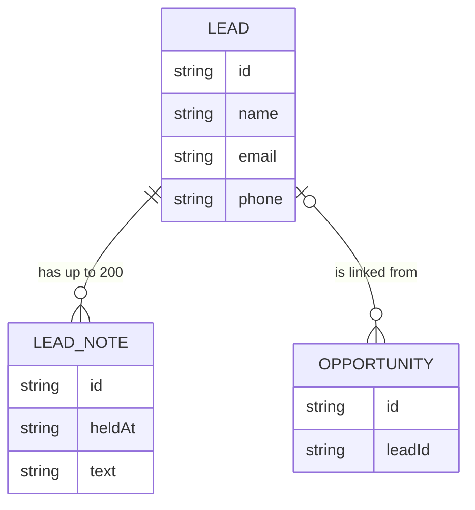

# Data Model: Notes on Networking Leads

## Lead note (new)

| Field | Type | Rules |
|---|---|---|
| `id` | string | Assigned by the API |
| `leadId` | string | The lead it belongs to |
| `heldAt` | ISO timestamp (UTC) | When the conversation was. Defaults to now; not in the future. Shown as its day |
| `text` | string | Required (blank refused, "Write a note"), up to 5,000 characters, line breaks kept |
| `createdAt`, `updatedAt` | ISO timestamp (UTC) | Set by the API |

Order: newest `heldAt` first, then newest `createdAt`.

## Networking lead (feature 010, changed)

- Gains `noteCount` in storage (0–200), kept by the note transactions. It isn't returned; the
  list returns the notes themselves.
- `GET /leads` returns `notes` with each lead.
- Deleting a lead deletes its notes.

## Storage (the existing table)

| Item | PK | SK | GSI1PK | GSI1SK |
|---|---|---|---|---|
| Lead | `LEAD#<leadId>` | `LEAD` | `LEADS` | `<leadId>` |
| Lead note (new) | `LEAD#<leadId>` | `NOTE#<noteId>` | `LEADS` | `<leadId>#NOTE#<noteId>` |

