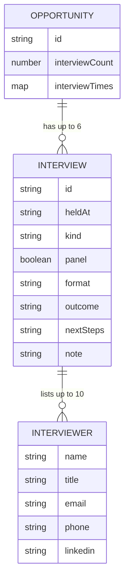

# Data Model: Interview Details

These changes add to feature 005's [data model](../005-interview-count/data-model.md). No new
item type, table or index.

## Interview (INTERVIEW# item): new attributes

| Attribute | Type | Rules |
|---|---|---|
| `kind` | `'HR' \| 'HIRING_MANAGER' \| 'BUSINESS' \| 'ENGINEERING' \| 'OTHER'`, optional | Labels: "HR / talent advisor", "Hiring manager", "Business", "Engineering", "Other" |
| `panel` | boolean, optional | Missing means no |
| `format` | `'PHONE' \| 'VIDEO' \| 'IN_PERSON'`, optional | Labels: "Phone", "Video", "In person" |
| `outcome` | `'WENT_WELL' \| 'NOT_SURE' \| 'WENT_BADLY'`, optional | Labels: "Went well", "Not sure", "Went badly". Kept whatever the date; shown only once the interview is past |
| `nextSteps` | string, optional | Trimmed; at most 500 characters; blank means none |
| `interviewers` | `Interviewer[]`, optional | At most 10, in the order given. Missing means none |

Changed rule for `heldAt`: at most one year after now (was: not in the future). Still not
before the opportunity's `createdAt`.

On a patch, `null` (or blank text, or `[]` for `interviewers`) clears an optional attribute.

## Interviewer (inside an interview)

| Attribute | Type | Rules |
|---|---|---|
| `name` | string | Required; trimmed; at most 100 characters |
| `title` | string, optional | At most 100 |
| `email` | string, optional | A valid address, as a lead's email; at most 254 |
| `phone` | string, optional | At most 50, as a lead's phone |
| `linkedin` | string, optional | At most 300; `https://` on `linkedin.com` or a subdomain, path starting `/in/`. `https://` is added when left out |

## Opportunity (OPP item): new attribute

| Attribute | Type | Rules |
|---|---|---|
| `interviewTimes` | map of interview id to `heldAt`, optional | One entry per interview. Changed in the same transaction as each add, date change and remove. Missing on older items until their first interview change (research §2) |

`interviewCount` is unchanged: every interview, past and upcoming, at most 6.

In API responses `interviewTimes` is a sorted array of times, not a map.

## Rules and messages

| Rule | Message | Field |
|---|---|---|
| Interview more than a year ahead | "An interview can't be more than a year ahead" | `heldAt` |
| Interview before the date added | "An interview can't be before the date added" (unchanged) | `heldAt` |
| A 7th interview, past or upcoming | "This opportunity already has 6 interviews, the most it can have" (unchanged) | — |
| An 11th interviewer | "An interview can have at most 10 interviewers" | `interviewers` |
| Interviewer without a name | "Name is required" | `interviewers.{n}.name` |
| Invalid email | "Enter a valid email address" | `interviewers.{n}.email` |
| Not a LinkedIn profile | "Enter a LinkedIn profile address" | `interviewers.{n}.linkedin` |
| Text over its limit | "Must be {n} characters or fewer" | the field |
| An unknown type, format or outcome | the allowed values | the field |

## Transactions

| Action | Items | Conditions |
|---|---|---|
| Start the map (before any of the below, only when it's missing) | Update OPP `SET interviewTimes = :all` | `attribute_not_exists(interviewTimes)`; a failure is ignored |
| Add | Put `INTERVIEW#<iid>`; Update OPP `interviewCount + 1`, `interviewTimes.#iid = :heldAt`, `updatedAt` | As in feature 005 |
| Edit, date changed | Update `INTERVIEW#<iid>`; Update OPP `interviewTimes.#iid = :heldAt`, `updatedAt` | Interview exists |
| Edit, date unchanged | Update `INTERVIEW#<iid>` | Interview exists |
| Remove | Delete `INTERVIEW#<iid>`; Update OPP `interviewCount - 1`, `REMOVE interviewTimes.#iid`, `updatedAt` | As in feature 005 |

## Derived values (not stored)

- **Upcoming or past**: `heldAt > now` is upcoming; anything else is past.
- **Interview summary** (`interviewSummary(o, now)`): `held` is the number of `interviewTimes` at
  or before now, plus `interviewCount` minus the number of `interviewTimes` (older interviews,
  all past). `nextAt` is the earliest time after now, or none.
- **Card badge**: "1 completed interview" or "{n} completed interviews" from `held`; nothing
  for 0. "Completed" sets it apart from the card's next upcoming interview (owner, 2026-11-10).
- **Timeline**: stage changes and past interviews only, oldest first, as in feature 005.
- **Interviews section order**: upcoming by `heldAt` ascending, then past by `heldAt`
  descending; ties by `recordedAt`.

## Diagram

The data-model diagram gains the interview's interviewers. Mermaid:

