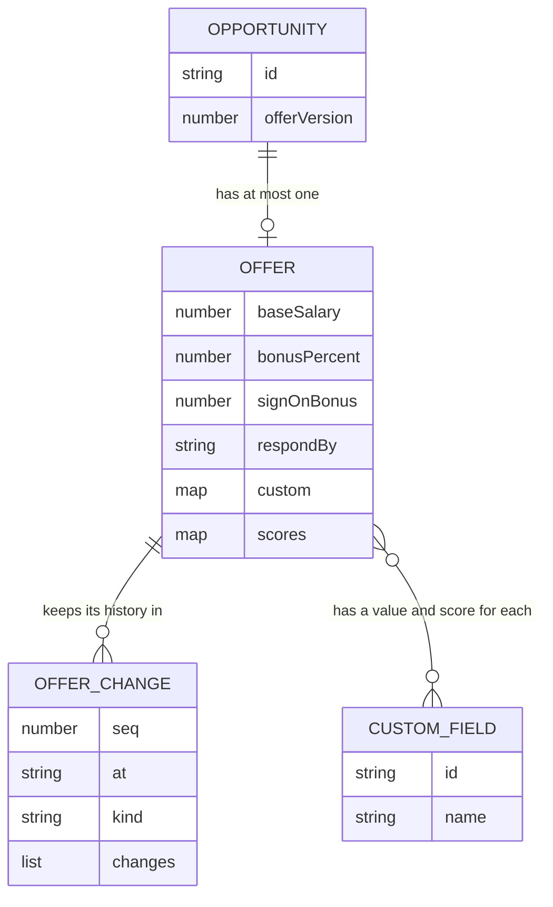

# Data Model: Offer Details and Comparison

These changes add to feature 001's [data model](../001-job-opportunity-tracker/data-model.md).
No new table or index.

## Opportunity (OPP item): new attributes

| Attribute | Type | Rules |
|---|---|---|
| `offer` | `Offer` map, optional | The offer's details. Missing means no offer |
| `offerScores` | map of detail key to 0–5, optional | Present (maybe empty) whenever `offer` is |
| `offerVersion` | integer, optional | Raised by each saved change; the history's condition |

## Offer (inside the opportunity)

| Attribute | Type | Rules |
|---|---|---|
| `baseSalary` | integer, optional | 0–10,000,000, as the salary range |
| `bonusPercent` | number, optional | 0–100, at most one decimal place |
| `signOnBonus` | integer, optional | 0–10,000,000 |
| `equity` | string, optional | At most 500 |
| `retirement` | string, optional | The 401k contribution. At most 500 |
| `insurance` | string, optional | At most 500 |
| `location` | string, optional | At most 500 |
| `workArrangement` | `'ONSITE' \| 'HYBRID' \| 'REMOTE'`, optional | As the opportunity's |
| `title` | string, optional | At most 200 |
| `role` | string, optional | At most 500 |
| `pto` | string, optional | At most 500 |
| `leadership` | string, optional | At most 500 |
| `culture` | string, optional | At most 500 |
| `startDate` | calendar date, optional | YYYY-MM-DD; any date |
| `respondBy` | calendar date, optional | YYYY-MM-DD; any date |
| `custom` | map of field id to string, optional | At most 500 each; ids of removed fields are dropped on the next save |
| `createdAt`, `updatedAt` | timestamps | When it was first recorded and last changed |

Text is trimmed; blank means none. On a change, `null` clears a detail.

**Score keys**: the detail names above (not `custom`, `createdAt` or `updatedAt`) and
`custom:<fieldId>`.

## Offer history entry (new item)

| Attribute | Type | Rules |
|---|---|---|
| `PK` | `OPP#<opportunityId>` | The opportunity's partition |
| `SK` | `OFFERCHANGE#<seq>` | Zero-padded to six digits, so entries sort in order |
| `seq` | integer | 1, 2, …; the `offerVersion` it made |
| `at` | timestamp | When it was saved |
| `kind` | `'RECORDED' \| 'CHANGED'` | The first save is `RECORDED` |
| `changes` | list of `{ field, from, to }` | A detail name or `custom:<fieldId>`; values or `null` |
| `via` | `'CLAUDE'`, optional | Saved through Claude |

Never changed; deleted only with the offer.

## Custom fields (new item)

| Attribute | Type | Rules |
|---|---|---|
| `PK`, `SK` | `SETTINGS`, `OFFER_FIELDS` | One item |
| `fields` | list of `{ id, name }` | Display order. At most 20; names trimmed, 1–60 characters, unique regardless of case |
| `removed` | list of `{ id, name }` | Fields removed, with their last name, so the history can still name them ("Commute (removed)"). Not counted in the 20, and a new field may reuse a removed name |
| `version` | integer | Raised by each change; the write's condition |

## Rules and messages

| Rule | Message | Field |
|---|---|---|
| An amount that isn't a whole number from 0 to 10,000,000 | "Enter a whole number, like 150000" (as the salary range) | `baseSalary`, `signOnBonus` |
| A bonus outside 0–100 or with two decimals | "Enter a percentage from 0 to 100, like 12.5" | `bonusPercent` |
| Text over its limit | "Must be {n} characters or fewer" | the field |
| A date that isn't YYYY-MM-DD | "Use a date like 2026-11-03" | `startDate`, `respondBy` |
| A value for a field that doesn't exist | "Unknown custom field" | `custom.<id>` |
| A score that isn't a whole number 0–5 | "Score with a whole number from 0 to 5" | `scores.<key>` |
| Scoring without an offer | "Add the offer before scoring it" | — |
| A 21st custom field | "You can have at most 20 custom fields" | `fields` |
| A blank, long or repeated field name | "Name the field", the limit, or "There's already a field called {name}" | `fields.<n>.name` |
| Removing a field, or the offer, without confirming | the confirm-header message, as for deleting | `X-Confirm-Delete` |
| A change racing another | "This opportunity changed since you loaded it. Reload and try again." (409) | — |

## Derived values (not stored)

- **Overall score**: the average of the scores for the current details and custom fields, 0s
  included, rounded to one decimal place; none scored means "Not scored".
- **Score label**: 0 "Not offered", 1 "Worst", 2 "Poor", 3 "Okay", 4 "Good", 5 "Best"; the
  overall uses its rounded score's color.
- **Respond-by text**: "Respond by {date}", warning within 3 days for an open opportunity, or
  "Response was due {date}" once passed.
- **On the Offers page**: an opportunity with `offer`, or with stage `OFFER`.

## Diagram

