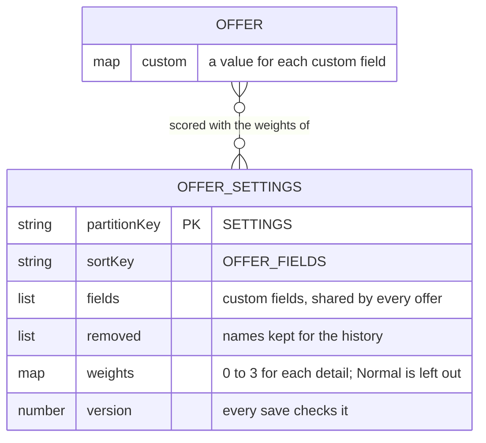

# Data Model: Offer Weights and a Settings Page

**Feature**: [spec.md](./spec.md) | **Date**: 2026-11-25

Nothing new is stored on opportunities or offers. The custom-fields item of feature 013
([data-model.md](../013-offer-comparison/data-model.md)) gains one attribute.

## Offer settings item (`PK = SETTINGS`, `SK = OFFER_FIELDS`), changed

| Attribute | Type | Rules |
|---|---|---|
| `fields` | list of `{ id, name }` | Unchanged (feature 013). |
| `removed` | list of `{ id, name }` | Unchanged (feature 013). |
| `weights` | map, key → number | **New.** Optional; missing means `{}`. Each key is an offer detail (`baseSalary`, …, `respondBy`) or `custom:<id>` of a field in `fields`. Each value is 0, 2 or 3. Normal (1) is never stored: setting a key to 1 removes it. |
| `version` | number | Unchanged meaning, now counting changes to `fields` **or** `weights`; every save is conditional on it. |

- **Removing a custom field** (through `PATCH /offer-fields`) also removes its `custom:<id>`
  key from `weights`.
- **Adding a custom field** stores nothing in `weights`, so it starts at Normal.
- **Old items** without `weights` read as `{}`: every detail Normal, and every overall score
  unchanged.

## Importance

| Value | Word | Counts as |
|---|---|---|
| 0 | Ignore (shown as "Ignored" on the comparison) | Not counted |
| 1 | Normal | 1× (the default) |
| 2 | Important | 2× |
| 3 | Critical | 3× |

`weightOf(key, weights) = weights[key] ?? 1`.

## The weighted overall score (computed, not stored)

For an offer with `offerScores`, the current `fields` and `weights`, consider each scored key
that's a detail or a current field's `custom:<id>`, and whose weight is above 0:

```text
overall = round1( Σ score × weightOf(key) ÷ Σ weightOf(key) )
```

- `round1(x) = Math.round(x × 10) / 10`, as today.
- With nothing to count, the overall is undefined, shown as "Not scored".
- With every weight 1 it equals feature 013's plain average.

## Diagram

The README's "What's stored" diagram changes its `CUSTOM_OFFER_FIELD` entity into the
settings item, with `weights`:


